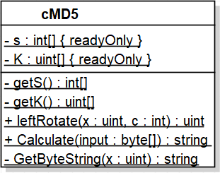
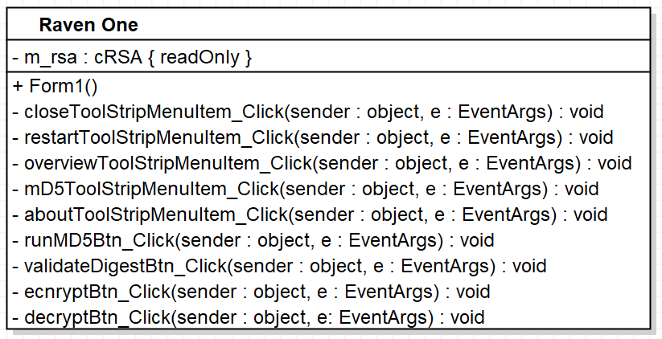
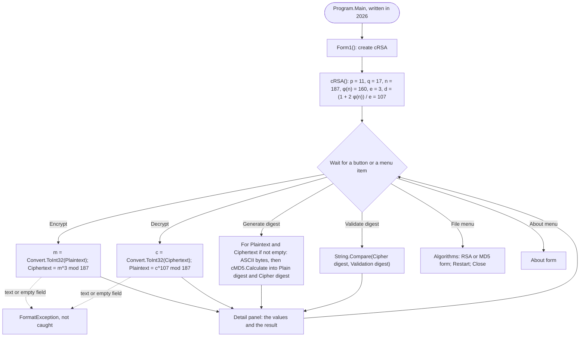
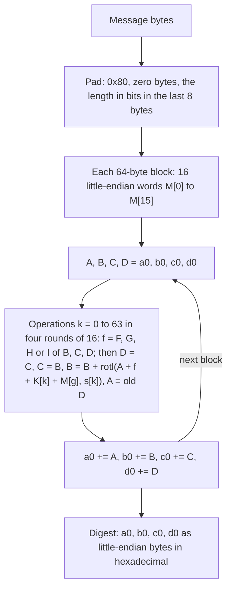

<!--
SPDX-FileCopyrightText: 2026 Mert Torun
SPDX-License-Identifier: CC-BY-4.0
-->

# Password- / Keyless authentication

Companion repository of the Bachelor's thesis by Mert Torun, TH Köln; submitted and examined in 2021, published open access in 2026: <https://doi.org/10.57683/EPUB-3598>. It holds Raven One SimuLink, the program written as the thesis's practical component; despite its name, it has no connection to MATLAB or Simulink.

[](https://doi.org/10.57683/EPUB-3598) [](LICENSES/CC-BY-4.0.txt) [](LICENSE) [](https://www.repostatus.org/#inactive)

> [!IMPORTANT]
> The version of record is the PDF deposited at TH Köln under the DOI above, and [`publication/`](publication/) holds it byte for byte. This repository is a record and is not developed further. Corrections go by e-mail, as [Corrections](#corrections) describes.

## Abstract

The aim of this academic thesis is to investigate and identify the usage possibilities, security and convenience of Password- / Keyless authentication. This is performed within the Web presence of Jamestown US-Immobilien GmbH to specify its use. These requirements will be analyzed in the context of authenticating transactions in the Jamestown Online (JTO, [A1]) application, presenting a passwordless approach.

In the first part, an introduction to Jamestown US-Immobilien GmbH, Fast IDentity Online (FIDO, [A2]) Alliance and passwords is given. These will show off their company profile, business field and the increasing demand of a convenient authentication in applications like JTO. Also showing off the limitations of password-based authentication, comparing them to the pros and cons of similar approaches.

The thesis subsequently identifies various methods in detail, and further outlines the structure of a passwordless-based approach in contrast to a password-based approach.

In conclusion, the thesis argues that convenient access to applications is essential for a company to stay competitive and presents an example for JTO.

[A1] and [A2] refer to the list of abbreviations of the thesis (p. 63): JTO, Jamestown Online; FIDO, Fast IDentity Online.

Keywords, as printed on p. 2: Secure; Convenient; Passwordless; Distributed; Authentication.

Corrections to the deposited thesis are listed in ERRATA.md.

### Title and abstract in other languages

<details>
<summary><span lang="de">Deutsch: Passwortlose und schlüssellose Authentifizierung</span></summary>

<div lang="de">

Ziel dieser wissenschaftlichen Arbeit ist es, die Einsatzmöglichkeiten, die Sicherheit und den Bedienkomfort passwortloser und schlüsselloser Authentifizierung zu untersuchen und zu ermitteln. Dies geschieht am Webauftritt der Jamestown US-Immobilien GmbH, um den Einsatz dieser Verfahren zu konkretisieren. Die entsprechenden Anforderungen werden im Kontext der Authentifizierung von Transaktionen in der Anwendung Jamestown Online (JTO) analysiert; dabei wird ein passwortloser Ansatz vorgestellt.

Der erste Teil stellt die Jamestown US-Immobilien GmbH und die Fast IDentity Online (FIDO) Alliance vor und führt in das Thema Passwörter ein. Dargestellt werden dabei deren Unternehmensprofil und Geschäftsfeld sowie der wachsende Bedarf an einer komfortablen Authentifizierung in Anwendungen wie JTO. Ebenso werden die Grenzen der passwortbasierten Authentifizierung aufgezeigt und den Vor- und Nachteilen vergleichbarer Ansätze gegenübergestellt.

Anschließend stellt die Arbeit verschiedene Verfahren im Detail vor und skizziert darüber hinaus den Aufbau eines passwortlosen Ansatzes im Gegensatz zu einem passwortbasierten Ansatz.

Abschließend argumentiert die Arbeit, dass ein komfortabler Zugang zu Anwendungen für ein Unternehmen wesentlich ist, um wettbewerbsfähig zu bleiben, und präsentiert ein Beispiel für JTO.

</div>

_As published in the catalogue record (https://doi.org/10.57683/EPUB-3598), supplied by the author in 2026; not part of the deposited PDF and not part of the thesis as submitted and examined in 2021. The English abstract of the deposited thesis is authoritative._

</details>

<details>
<summary><span lang="fr">Français: Authentification sans mot de passe et sans clé</span></summary>

<div lang="fr">

L’objectif de ce mémoire est d’étudier et de déterminer les possibilités d’utilisation, la sécurité et la praticité de l’authentification sans mot de passe et sans clé. L’étude est menée dans le cadre de la présence en ligne de Jamestown US-Immobilien GmbH afin de préciser l’usage de ces procédés. Les exigences correspondantes sont analysées dans le contexte de l’authentification des transactions dans l’application Jamestown Online (JTO) ; une approche sans mot de passe y est présentée.

La première partie présente Jamestown US-Immobilien GmbH, la FIDO Alliance (Fast IDentity Online) et les mots de passe. Elle expose le profil et le domaine d’activité de l’entreprise et de l’alliance, ainsi que la demande croissante d’une authentification pratique dans des applications telles que JTO. Les limites de l’authentification par mot de passe y sont également mises en évidence et comparées aux avantages et aux inconvénients d’approches similaires.

Ce mémoire décrit ensuite en détail différentes méthodes et esquisse en outre la structure d’une approche sans mot de passe, par opposition à une approche par mot de passe.

En conclusion, ce mémoire défend l’idée qu’un accès pratique aux applications est essentiel pour qu’une entreprise reste compétitive, et présente un exemple pour JTO.

</div>

_As published in the catalogue record (https://doi.org/10.57683/EPUB-3598), supplied by the author in 2026; not part of the deposited PDF and not part of the thesis as submitted and examined in 2021. The English abstract of the deposited thesis is authoritative._

</details>

<details>
<summary><span lang="tr">Türkçe: Parolasız/Anahtarsız Kimlik Doğrulama</span></summary>

<div lang="tr">

Bu tezin amacı, parolasız/anahtarsız kimlik doğrulamanın kullanım olanaklarını, güvenliğini ve kullanım kolaylığını incelemek ve belirlemektir. Çalışma, söz konusu kullanımı somutlaştırmak amacıyla Jamestown US-Immobilien GmbH'nın çevrimiçi varlığı kapsamında gerçekleştirilmektedir. İlgili gereksinimler, Jamestown Online (JTO) uygulamasındaki işlem doğrulaması bağlamında analiz edilmekte ve parolasız bir yaklaşım sunulmaktadır.

İlk bölümde Jamestown US-Immobilien GmbH, Fast IDentity Online (FIDO) Alliance ve parolalar hakkında bir giriş sunulmaktadır. Bu bölümde şirket profilleri, faaliyet alanları ve JTO gibi uygulamalarda kullanım kolaylığı sunan bir kimlik doğrulamaya duyulan artan talep ele alınmaktadır. Ayrıca parola tabanlı kimlik doğrulamanın sınırlılıkları ortaya konulmakta ve bunlar benzer yaklaşımların avantajları ve dezavantajlarıyla karşılaştırılmaktadır.

Ardından tez, çeşitli yöntemleri ayrıntılı biçimde ele almakta ve ayrıca parola tabanlı bir yaklaşıma kıyasla parolasız bir yaklaşımın yapısını ana hatlarıyla ortaya koymaktadır.

Sonuç olarak tez, uygulamalara kolay erişimin bir şirketin rekabet gücünü koruyabilmesi için temel bir öneme sahip olduğunu savunmakta ve JTO için bir örnek sunmaktadır.

</div>

_As published in the catalogue record (https://doi.org/10.57683/EPUB-3598), supplied by the author in 2026; not part of the deposited PDF and not part of the thesis as submitted and examined in 2021. The English abstract of the deposited thesis is authoritative. The record lists this language as mul._

</details>

<details>
<summary><span lang="es">Español: Autenticación sin contraseña y sin clave</span></summary>

<div lang="es">

El objetivo de este trabajo académico es investigar y determinar las posibilidades de uso, la seguridad y la comodidad de la autenticación sin contraseña y sin clave. El estudio se lleva a cabo en el marco de la presencia web de Jamestown US-Immobilien GmbH con el fin de concretar su aplicación. Los requisitos correspondientes se analizan en el contexto de la autenticación de transacciones en la aplicación Jamestown Online (JTO), para la que se presenta un enfoque sin contraseña.

En la primera parte se presentan Jamestown US-Immobilien GmbH, la Fast IDentity Online (FIDO) Alliance y las contraseñas. Se exponen el perfil y el ámbito de actividad de la empresa y de la alianza, así como la creciente demanda de una autenticación cómoda en aplicaciones como JTO. Asimismo, se muestran las limitaciones de la autenticación basada en contraseñas y se contrastan con las ventajas e inconvenientes de enfoques similares.

A continuación, el trabajo describe en detalle diversos métodos y esboza además la estructura de un enfoque sin contraseña frente a un enfoque basado en contraseñas.

Como conclusión, el trabajo sostiene que un acceso cómodo a las aplicaciones resulta esencial para que una empresa mantenga su competitividad, y presenta un ejemplo para JTO.

</div>

_As published in the catalogue record (https://doi.org/10.57683/EPUB-3598), supplied by the author in 2026; not part of the deposited PDF and not part of the thesis as submitted and examined in 2021. The English abstract of the deposited thesis is authoritative._

</details>

## Publication

| Field | Value |
| --- | --- |
| Type | Bachelor's thesis |
| Institution | TH Köln (Technische Hochschule Köln) |
| Faculty | Faculty of Information, Media and Electrical Engineering (F07) |
| Institute | Institut für Nachrichtentechnik (INT), as the thesis and its catalogue record name it |
| Programme | B.Sc. Computer Science & Engineering (Technische Informatik), Embedded Systems |
| Reviewers | Prof. Dr. Michael Silverberg (First reviewer, TH Köln); Frank Mördel (Second reviewer, Jamestown US-Immobilien GmbH, Cologne) |
| Partner company | Jamestown US-Immobilien GmbH, Cologne, named in the thesis as the setting of the work |
| Submitted | 2021-06-30 |
| Examined | 2021-07-05 |
| Published | 2026-09-14, open access on ePublications, a publication server of TH Köln |
| DOI | <https://doi.org/10.57683/EPUB-3598> |
| URN | [urn:nbn:de:hbz:832-epub4-35985](https://nbn-resolving.org/urn:nbn:de:hbz:832-epub4-35985) |
| Licence | CC BY 4.0; material of third parties excepted, see [`NOTICE`](NOTICE) |
| Language | English |
| Pages | 72 |
| Classification | DDC 004 (Data processing & computer science); ACM CCS 1998: E.3 (Data Encryption), subentry "Public key cryptosystems", and K.6.5 (Security and Protection), subentry "Authentication" |

## Version of record

| Role | File | Bytes | SHA-256 |
| --- | --- | --- | --- |
| Version of record, byte-identical with the file the catalogue record serves | [`Torun_Password_Keyless_Authentication.pdf`](publication/Torun_Password_Keyless_Authentication.pdf) | 7,035,230 | `467ef888c8e499db7985edfd43b86148c564345b2479410f6e1a39ee2b4039ee` |
| Reading copy with downsampled images; not the version of record, do not cite it | [`Torun_Password_Keyless_Authentication_reading-copy.pdf`](publication/Torun_Password_Keyless_Authentication_reading-copy.pdf) | 3,376,312 | `49f56da990b4a9d993c392e2c27df5439623df9d0e66edb76f7f4865c7461100` |

The deposited file differs from the thesis as submitted in 2021 in that the signature images on pages 70 and 71 and the author's matriculation number were removed; the restriction notice on page 2 and the blocking notice on page 71 remain, and the restriction they state ended on 2024-06-30. The tag `epub-3598` marks the state of this repository that holds the deposited file and the appendix code as printed. [`publication/README.md`](publication/README.md) gives the ways to verify both files, with and without a GitHub account.

## The work in brief

| Chapter | From page | Content |
| --- | --- | --- |
| 1 Introduction | 5 | The FIDO Alliance and the partner company, Jamestown, and the plan of the thesis |
| 2 Passwords | 10 | Knowledge-, token- and biometric-based authentication, weighed against each other in Table 1 (p. 20) |
| 3 Cryptography | 17 | The fundamental model; private-key cryptography (AES) and public-key cryptography (RSA); digital signatures and hash functions, with MD5; steganography; key distribution with Diffie-Hellman and the authentication of public keys; transactions |
| 4 FIDO Alliance Specifications | 38 | Universal Second Factor (U2F), the Universal Authentication Framework (UAF) and the Client to Authenticator Protocols (CTAP) |
| 5 From inconvenient to convenient | 42 | Raven One SimuLink (pp. 42-48); passwordless sign-in for the partner company's customer portal, Jamestown Online (5.1, p. 49), and for its online subscription form (5.2, p. 51) |
| 6 Conclusion | 52 | Modern authentication as a requirement for companies; quoted below |
| 7 Appendix | 53 | The source code of Raven One SimuLink: `cMD5.cs` (pp. 53-56), `cRSA.cs` (pp. 56-58) and `Raven One.cs` (pp. 58-62) |
| 8 to 13 | 63 | List of abbreviations, list of figures, list of tables, references, statutory declaration, blocking notice |

The conclusion opens: "In conclusion, we can say that offering modern authentication is a must-have for companies nowadays." Of the program it says: "The covered algorithms for cryptographic functions like RSA, AES or MAC and the Raven One SimuLink Software do indeed show on a low-level base of software, that it’s possible and secure to enable these modern algorithms." (p. 52). [`ERRATA.md`](ERRATA.md) corrects two statements of the conclusion (E-021 and E-022), and [Limitations](#limitations) states what the program does and does not show.

## Contents

| Path | Content | In the thesis | Licence |
| --- | --- | --- | --- |
| [`src/cMD5.cs`](src/cMD5.cs) | The MD5 class | Appendix I, pp. 53-56; background in 3.2.3, Digital Signatures (p. 29) | MIT; GPL-3.0-or-later at `epub-3598` |
| [`src/cRSA.cs`](src/cRSA.cs) | The RSA class | Appendix II, pp. 56-58; background in 3.2.2, Public-Key Cryptography (p. 25) | MIT; GPL-3.0-or-later at `epub-3598` |
| [`src/Raven One.cs`](src/Raven%20One.cs) | The logic of the main window, class `Form1` | Appendix III, pp. 58-62 | MIT; GPL-3.0-or-later at `epub-3598` |
| [`src/Program.cs`](src/Program.cs) | Entry point, and declarations of the forms and controls the printed files use; written in 2026 | not in the thesis | MIT |
| `RavenOneSimuLink.csproj`, `Directory.Build.props`, `global.json` | Build files, written in 2026 | not in the thesis | MIT |
| [`verification/`](verification/) | Claim check, appendix check, reading copy check, metadata and link checks | not in the thesis | MIT; the transcription from Figure 32 and the folder's README CC BY 4.0 |
| [`publication/`](publication/) | The deposited thesis, its reading copy and their checksums | the whole thesis | CC BY 4.0, material of third parties excepted |
| [`docs/figures/`](docs/figures/) | Figures 32 to 36 of the thesis | pp. 42-47 | CC BY 4.0 |
| [`slides/colloquium-handout-2021-07-05.de.pdf`](slides/colloquium-handout-2021-07-05.de.pdf) | Colloquium handout, 2021-07-05, in German; not part of the deposited thesis | not in the thesis | CC BY 4.0, two marks and one table excepted |
| [`docs/social/`](docs/social/) | Social card and the script that renders it | not in the thesis | CC BY 4.0; the script MIT |
| [`ERRATA.md`](ERRATA.md), [`CHANGELOG.md`](CHANGELOG.md), [`NOTICE`](NOTICE), [`CITATION.cff`](CITATION.cff), [`codemeta.json`](codemeta.json) | Errata, changes, licences and credits, citation metadata | not in the thesis | CC BY 4.0 |

### Provenance of the code

The three appendix files are the author's source files of 2021, stored with LF line endings and without a byte order mark. At the tag `epub-3598` their header comments are as the deposited thesis prints them, GPL notice included; the header line that held the author's matriculation number is blank there and here. In the next commit the author relicensed them under the MIT License: each header keeps its printed lines and replaces the GPL notice with SPDX tags and a note on the licence history. The code below the headers has not changed since 2021. [`verification/check_appendix.py`](verification/check_appendix.py) checks this on every push: it compares each file with pp. 53-62 of the deposited PDF, line by line with whitespace removed, the whole header at the tag and the printed header lines afterwards; its self-test changes one token per file and must fail. `src/Program.cs` is not in the thesis: the entry point and the designer file of 2021 were not preserved, and it was written in 2026 so that the printed files compile.

## Raven One SimuLink

Raven One SimuLink is a Windows Forms program in C#, written by the author from April to June 2021 for .NET Framework 4.7.2 (thesis, p. 43; the months stand in the headers of the source files). The thesis says that the software "is used to demonstrate exemplary cryptographic algorithms" (p. 43): it encrypts and decrypts with RSA, computes MD5 digests and compares two digests. Figure 32 shows the program running in 2021. According to the author, the examiners saw and tested it; no record of that survives. The thesis's Figures 32 to 36 and the program flow below document the program; what Figure 32 shows beyond the printed code is stated under [Limitations](#limitations). Here it is built for .NET 10; at the tag `epub-3598`, for .NET 8.

> [!CAUTION]
> Raven One SimuLink is a demonstration implementation, not cryptography for use. Its RSA works with the primes 11 and 17 and without padding, and its MD5, a hash function that is no longer collision resistant, returns wrong digests for some input lengths. Do not use the program, or code from it, to protect data.

### Figures from the thesis


_Figure 32, [F32]: Raven One SimuLink overview (thesis, p. 42)._


_Figure 33, [F33]: Raven One SimuLink RSA uml type class diagram (thesis, p. 44)._



_Figure 34, [F34]: Raven One SimuLink MD5 uml type class diagram (thesis, p. 45)._



_Figure 35, [F35]: Raven One SimuLink main gui uml type class diagram (thesis, p. 46). The list of figures calls it an activity diagram (ERRATA.md, E-027). The diagram writes the handler of the Encrypt button as `ecnryptBtn_Click`; the code calls it `encryptBtn_Click` (ERRATA.md, E-034)._


_Figure 36, [F36]: Raven One SimuLink RSA uml type activity diagram (thesis, p. 47). Two labels are German, as printed: "Plaintext auslesen" and "Ciphertext auslesen" mean "read the plaintext" and "read the ciphertext". In the code, the keys are computed once, when the window is created, and not before each encryption._

### Program flow

The diagram shows the flow of the program of 2021 as the printed code gives it: the handlers in `src/Raven One.cs` and the RSA in `src/cRSA.cs`. Which button or menu item calls which handler is inferred from the handlers' names and Figures 32 and 35, because the designer file that wired them was not preserved; `src/Program.cs` of 2026 only opens the window. The table after it gives the same steps as text.



### What each control does

| Control | Computation, method in `src/Raven One.cs` | Text in the detail panel |
| --- | --- | --- |
| Encrypt | `encryptBtn_Click` clears Ciphertext, Cipher digest and the panel; Ciphertext becomes `encryptPlaintext(Plaintext)`, m^3 mod 187 of the decimal integer m in Plaintext | `P-Value: 11`, `Q-Value: 17`, `N = p * q Value: 187`, `Phi(n) = (p-1)*(q-1) Value: 160`, `Encryption key: 3`, `Decryption key: 107`, `Encrypted Value using p^e mod n which is 42^3 % 187`, `Result: 36` (for m = 42) |
| Decrypt | `decryptBtn_Click` clears Plaintext, Plain digest and the panel; Plaintext becomes `decryptCiphertext(Ciphertext)`, c^107 mod 187 | the same six lines, then `Decrypted Value using c^d mod n which is 36^107 % 187` and `Result: 42` |
| Generate digest | `runMD5Btn_Click` hashes the ASCII bytes of Plaintext and of Ciphertext, each if not empty, with `cMD5.Calculate` into Plain digest and Cipher digest | per field: `Generating plaintext digest value using MD5 algorithm` (or ciphertext), the text, its ASCII codes and the digest; with both fields empty, `Error, please input plaintext or ciphertext values...` |
| Validate digest | `validateDigestBtn_Click` compares Cipher digest with the typed Validation digest as strings (`String.Compare`); no key is involved | both digests and their ASCII codes, then `Both digest values are equal` or `Both digest values are not equal`; with a field empty, an error line |
| File, Algorithms, RSA or MD5; About | `overviewToolStripMenuItem_Click`, `mD5ToolStripMenuItem_Click`, `aboutToolStripMenuItem_Click` open the description forms `RSA`, `MD5` and `About`; their content of 2021 is not preserved | none |
| File, Restart; File, Close | `restartToolStripMenuItem_Click` calls `Application.Restart`, `closeToolStripMenuItem_Click` calls `Environment.Exit(0)` | none |

In the detail panel, "P-Value" is the prime p, while "p^e mod n" writes the plaintext P of equation (5.4) of the thesis, C = P^e mod n.

### RSA with the program's parameters

Section 3.2.2 of the thesis, Public-Key Cryptography (p. 25), defines RSA and works an example with the primes 5 and 17 (pp. 27-28). Chapter 5 describes the RSA of the program (p. 47), and `src/cRSA.cs` implements it.

Chapter 3 and chapter 5 of the thesis write RSA in different notations, and the code and the detail panel in two more. This README uses the first column:

| This README | Chapter 3, pp. 27-28 | Chapter 5, p. 47 | `src/cRSA.cs` | Detail panel |
| --- | --- | --- | --- | --- |
| p, the first prime | p1 | p | `m_p` | `P-Value` |
| q, the second prime | p2 | q | `m_q` | `Q-Value` |
| n = p · q | n | n | `m_n` | `N = p * q Value` |
| φ(n) = (p-1)(q-1) | φ(n) | phi_n | `m_phi_n` | `Phi(n) = (p-1)*(q-1) Value` |
| e, the public exponent | e, the key KE | e; (n, e) is the public key | `m_e` | `Encryption key` |
| d, the private exponent | d, the key KD | d; (n, d) is the private key | `m_d` | `Decryption key` |
| m, the plaintext as an integer | m; m' after decryption | P | the argument of `encryptPlaintext` | p in `p^e mod n` |
| c, the ciphertext | y | C | the argument of `decryptCiphertext` | c in `c^d mod n` |

The constructor of `cRSA` fixes the two primes, which the thesis calls "constants in the SimuLink software, for testing purposes" (p. 47):

```math
p = 11, \quad q = 17, \quad n = p \cdot q = 187, \quad \varphi(n) = (p-1)(q-1) = 160
```

The public exponent e is the first integer from 3 upwards with gcd(e, φ(n)) = 1, so e = 3. The private exponent comes from a closed form, not from the extended Euclidean algorithm that p. 47 names:

```math
d = \frac{1 + 2\,\varphi(n)}{e} = \frac{321}{3} = 107, \qquad e \cdot d = 321 = 2 \cdot 160 + 1 \equiv 1 \pmod{160}
```

Encryption computes c = m^e mod n and decryption m = c^d mod n. For m = 42:

```math
c = 42^{3} \bmod 187 = 74088 \bmod 187 = 36, \qquad m = 36^{107} \bmod 187 = 42
```

This is textbook RSA. The comment in `cRSA.cs` points to RFC 8017; the two operations are the RSA primitives of that RFC, RSAEP and RSADP, without the range check of their first step, and none of its encoding schemes, OAEP or PKCS #1 v1.5, is implemented.

### MD5

Section 3.2.3 of the thesis, Digital Signatures (p. 29), introduces hash functions, names MD5 and prints an MD5 collision (pp. 29-31). Chapter 5 describes the MD5 of the program (pp. 45 and 48), and `src/cMD5.cs` implements it. The Validate digest button compares two digests; a signature as section 3.2.3 describes it, a hash value encrypted with a key, is not computed (see [Limitations](#limitations)).

`cMD5.Calculate` pads the message, splits it into blocks of 64 bytes, each read as 16 little-endian words of 32 bits, and runs 64 operations per block, in four rounds of 16, on the registers A, B, C and D. The registers start from a0 = 0x67452301, b0 = 0xefcdab89, c0 = 0x98badcfe and d0 = 0x10325476, the constants the thesis lists on p. 48.



| Round | Operation k | Function f | Word index g |
| --- | --- | --- | --- |
| 1 | 0-15 | F = (B AND C) OR (NOT B AND D) | k |
| 2 | 16-31 | G = (D AND B) OR (NOT D AND C) | (5k + 1) mod 16 |
| 3 | 32-47 | H = B XOR C XOR D | (3k + 5) mod 16 |
| 4 | 48-63 | I = C XOR (B OR NOT D) | 7k mod 16 |

K[k] is the integer part of 2^32 · abs(sin(k + 1)), and s[k] the number of bits by which operation k rotates. P. 48 prints the shift amounts as the 16 values of a table with one row of four per round; `cMD5` holds all 64, each row of four repeated four times. The order of the assignments matters: C takes the old value of B before B changes.

<details>
<summary>The first operation for the input "admin"</summary>

- Input: `admin`, 5 bytes.
- Padded block of 64 bytes: the input, the byte 0x80, 50 zero bytes and the length of 40 bits as a little-endian 64-bit number:
  `61646d696e8000000000000000000000000000000000000000000000000000000000000000000000000000000000000000000000000000002800000000000000`
- Registers before operation 0: A = 0x67452301, B = 0xefcdab89, C = 0x98badcfe, D = 0x10325476.
- Operation 0 uses F and the word M[0]. After it: A = 0x10325476, B = 0x5bd217a9, C = 0xefcdab89, D = 0x98badcfe.
- The digest after all 64 operations: `21232f297a57a5a743894a0e4a801fc3`.

The claim check computes these values with the tables and the rotation of `cMD5` itself (checks `md5-admin-trace` and `md5-admin`).

</details>

The thesis prints two 128-byte blocks with the same MD5 digest, 79054025255fb1a26e4bc422aef54eb4 (p. 31). They differ in 6 bytes, and `cMD5` returns that digest for both. The window cannot hash them, because it encodes its text fields as ASCII, in which bytes above 0x7F do not exist.

## Reproducing

This section reproduces the behaviour of the program, not the conclusions of the thesis about authentication at the partner company.

Tested environment: on 2026-10-02 the claim check was built and run with the .NET SDK 10.0.401 on macOS (arm64), and its output is `verification/expected-output.txt`; CI builds the program and runs the claim check on ubuntu-24.04 with the SDK that `global.json` names. .NET 10 is a long-term support release, supported until 2028-11-14. The Windows Forms program was not run on Windows in 2026.

Build, on any operating system with the .NET SDK 10.0.401 or a later 10.0.4xx patch, as `global.json` requires:

```sh
dotnet build RavenOneSimuLink.csproj -c Release
```

The output goes to `artifacts/bin/RavenOneSimuLink/release/`. On Linux and macOS the project compiles because it sets `EnableWindowsTargeting`; the restore downloads the Windows reference packages. On Windows, `dotnet run --project RavenOneSimuLink.csproj -c Release` opens an empty main window; this follows from `src/Program.cs`, not from a run: it declares the controls without laying them out or wiring their events, and it declares no menus, because the designer file of 2021 was not preserved (see [Limitations](#limitations)).

Claim check, on any operating system, with the same SDK:

```sh
dotnet run --project verification/ClaimCheck -c Release
```

It runs the printed MD5 and RSA code, prints one line per check and ends with `OK: 18 of 18 checks hold`; [`verification/expected-output.txt`](verification/expected-output.txt) is the expected output.

| Claim | Where it is stated | Check |
| --- | --- | --- |
| p = 11, q = 17, n = 187, φ(n) = 160, e = 3, d = 107, e · d ≡ 1 (mod 160) | RSA with the program's parameters | `rsa-parameters`, `rsa-key-relation` |
| m = 42 gives c = 36, and every m from 0 to 186 comes back | RSA with the program's parameters | `rsa-example-42`, `rsa-round-trip` |
| An m of 187 or more comes back as m mod 187: 200 gives 140, which gives 13 | Limitations, `SECURITY.md` | `rsa-reduction` |
| A negative m that is not a multiple of 187 gives a negative result: -5 gives -125, which gives -5; -187 gives 0 | Limitations, `SECURITY.md` | `rsa-negative` |
| Text or an empty field raises FormatException; a number beyond the 32-bit range raises OverflowException | Limitations, `SECURITY.md` | `rsa-text-input`, `rsa-int32-range` |
| The closed form of d holds for 11 and 17, not for 11 and 13 | Limitations | `rsa-closed-form` |
| The digest of "admin" and its first operation | MD5 | `md5-admin`, `md5-admin-trace` |
| The two blocks of p. 31 have the same digest | MD5 | `md5-collision-p31` |
| Of the lengths from 0 to 255 bytes, cMD5 is wrong for exactly those of 56 to 62 bytes modulo 64, and so for one input of the RFC 1321 test suite | Limitations, `SECURITY.md` | `md5-padding-defect`, `md5-rfc1321-suite` |
| Characters outside ASCII become byte 63 | Limitations | `ascii-non-ascii` |
| The digests of Figure 32, and the 256 bytes of its ciphertext | Limitations | `md5-figure-32-plain`, `md5-figure-32-cipher` |

The version of record, and the appendix code against the printed listing (the second command needs `pdftotext` from poppler-utils):

```sh
cd publication && sha256sum -c SHA256SUMS && cd ..
python3 verification/check_appendix.py
```

[`publication/README.md`](publication/README.md) adds the checks with the signed tag and with the release.

## Limitations

Of the thesis: chapter 5 describes passwordless sign-in for the partner company's customer portal (5.1) and for its online subscription form (5.2) at a high level (p. 49). The thesis implements and evaluates neither; it sets the partner company's test of FIDO hardware tokens aside (p. 49) and leaves the subscription form to a later step of the planning (p. 51). The program demonstrates the RSA and MD5 of chapter 3, not passwordless sign-in. The conclusion that the program shows these algorithms to be secure is not supported (E-022).

Of the program, as the appendix prints it:

- **MD5 padding.** For a message whose length in bytes is 56 to 62 modulo 64, the remainder in the padding computation is negative in C#, the buffer is one block too short, and the length is written over the byte 0x80 or the end of the message, so the digest is wrong. Of the lengths from 0 to 255 bytes, 56-62, 120-126, 184-190 and 248-254 give wrong digests, the other 228 right ones; of the seven inputs of the RFC 1321 test suite, the one of 62 bytes fails ([`ERRATA.md`](ERRATA.md), E-024).
- **MD5 length field.** The length in bits is written as a 32-bit number into the 64-bit field, so an input of 2^29 bytes (512 MiB) or more does not get the digest of RFC 1321. This follows from the code and was not run.
- **Text encoding.** The window encodes its fields with `Encoding.ASCII`, so every character outside ASCII, such as ä, becomes byte 63, "?", before it is hashed.
- **RSA input.** The RSA code takes decimal integers only. Text or an empty field raises a FormatException in `Convert.ToInt32`, and a number beyond the 32-bit range an OverflowException; no handler catches them. Of the non-negative integers, those below 187 come back unchanged and larger ones come back reduced modulo 187: 200 is encrypted to 140, which is decrypted to 13. A negative integer that is not a multiple of 187 gives a negative result: -5 is encrypted to -125, which is decrypted to -5; a negative multiple of 187 gives 0. No padding is applied (E-016).
- **RSA keys.** d comes from the closed form (1 + 2 φ(n)) / e, which gives the inverse of e modulo φ(n) for p = 11 and q = 17 but not in general: for p = 11 and q = 13 it gives e = 7 and d = 34, and 7 · 34 mod 120 = 118. P. 47 names the extended Euclidean algorithm (E-019).
- **"Digital signature".** The thesis says that the program generates and verifies digital signatures with MD5 (p. 43). The program computes MD5 digests and compares two digest strings; it applies no key to a digest (E-017).

**Figure 32.** The figure shows the plaintext "Hallo" and, in the Ciphertext field, 344 characters of the Base64 alphabet ending in "==", which decode to 256 bytes. The encryption code printed in the appendix accepts only a decimal integer and returns a decimal number below 187; for "Hallo" it raises a FormatException. The two MD5 digests in the figure are those of the printed MD5 code: d1bf93299de1b68e6d382c893bf1215f for "Hallo" and fbae09a483269207be36423cbeaf2f92 for the 344 characters, which [`verification/figure-32-ciphertext.txt`](verification/figure-32-ciphertext.txt) transcribes. How the ciphertext in the figure was produced is not known (E-015).

**Not preserved.** The designer file with the layout of the main window, the three description forms (RSA, MD5 and About), the project files of 2021, the digital appendix handed out with the thesis (p. 43) and the UML files for the Violet UML Editor (p. 44). `src/Program.cs` declares the forms and controls so that the printed files compile, but does not lay them out, wire their events or declare the menus, so a build opens an empty window.

**Accessibility of the deposit.** The deposited PDF is untagged and declares no document language. As the version of record it cannot be changed, so making it accessible lies outside this repository; the abstracts, the figures with their alternative texts and the tables above are its accessible summary.

## Corrections

[`ERRATA.md`](ERRATA.md) lists the known errors of the thesis, the properties of its catalogue record and deposited file, and the web addresses of the thesis that no longer work or have moved. The deposited file does not change: a confirmed error is added to `ERRATA.md`, and an error that affects a result is reported to the library.

This repository takes no issues. Please send a correction by e-mail to [info@mtorun0x7cd.com](mailto:info@mtorun0x7cd.com), with:

- the item: the thesis, the code, this README or the metadata;
- the location: the page of the thesis, or the file and line;
- the quoted text;
- the proposed correction;
- the evidence;
- a note that you checked `ERRATA.md`.

## Citation

APA:

Torun, M. (2026). _Password- / keyless authentication_ [Bachelor's thesis, Technische Hochschule Köln; submitted 2021]. ePublications TH Köln. <https://doi.org/10.57683/EPUB-3598>

BibTeX:

```bibtex
@mastersthesis{Torun2026,
  author = {Torun, Mert},
  title  = {Password- / Keyless authentication},
  school = {Technische Hochschule Köln},
  type   = {Bachelor's thesis},
  year   = {2026},
  doi    = {10.57683/EPUB-3598},
  url    = {https://doi.org/10.57683/EPUB-3598},
  note   = {Submitted 2021-06-30, examined 2021-07-05; published 2026}
}
```

GitHub's "Cite this repository" reads [`CITATION.cff`](CITATION.cff) and renders the thesis as `@misc`, without its school; the entry above cites it as a Bachelor's thesis.

## License

| Path | Licence |
| --- | --- |
| `src/cMD5.cs`, `src/cRSA.cs`, `src/Raven One.cs` | MIT; at the tag `epub-3598` GPL-3.0-or-later, as the thesis prints them |
| `src/Program.cs`, the build files, the scripts and the claim check in `verification/`, `.github/`, `.githooks/`, `docs/social/render.sh` | MIT |
| `publication/*.pdf`, `docs/figures/`, `slides/` | CC BY 4.0, the licence of the thesis; the material of third parties and the marks of TH Köln and of the partner company are excepted, see [`NOTICE`](NOTICE) |
| This README and the other documentation, `CITATION.cff`, `codemeta.json`, `verification/figure-32-ciphertext.txt`, `docs/social/social-card.*` | CC BY 4.0 |

The three appendix files were printed in 2021 under the GNU General Public License, version 3 or later, and stand under it at the tag `epub-3598`. Their author, the sole rights holder, relicensed them under the MIT License in the commit after that tag; copies received under the GPL keep that grant. [`LICENSE`](LICENSE) holds the MIT License and [`LICENSES/`](LICENSES/) the texts of the licences in use; [`REUSE.toml`](REUSE.toml) and the SPDX tags in the files give the licence of every file.

## Contact

Mert Torun, [info@mtorun0x7cd.com](mailto:info@mtorun0x7cd.com)
